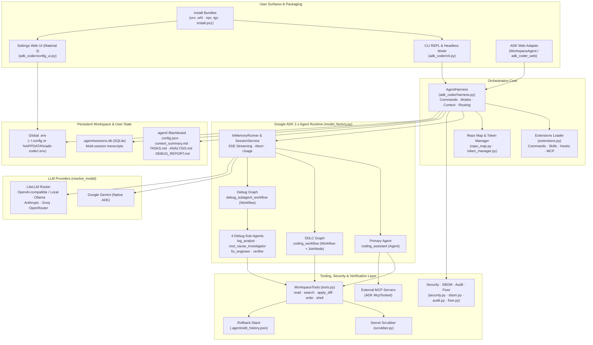
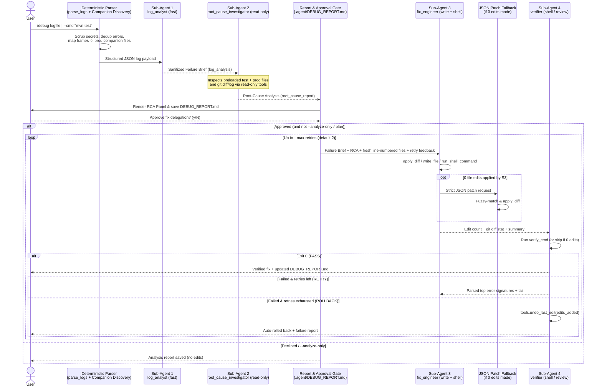
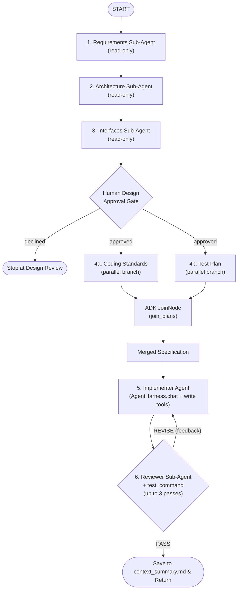

# ADK Coder — System & Multi-Agent Architecture

`adk-coder` is a local-first, Google ADK 2.x coding assistant built around a central `AgentHarness`, an ADK `InMemoryRunner` + `Workflow` graph runtime, scoped workspace tools with safety/rollback guards, and specialized sub-agents for SDLC engineering, codebase analysis, and automated debugging.

---

## 1. High-Level System Architecture

---

## 2. How Many Agents Are Working?

`adk-coder` runs on **Google ADK 2.x** (`Agent`, `BaseAgent`, `Workflow`, `JoinNode`, `AgentTool`, `InMemoryRunner`). Depending on the command you invoke, work is handled by:

- **2 ADK `Workflow` Graph Orchestrators** (`coding_workflow`, `debug_subagent_workflow`)
- **4 Named Debug Sub-Agents** (`log_analyst`, `root_cause_investigator`, `fix_engineer`, `verifier`)
- **1 Primary Interactive Coding Agent** (`coding_assistant`, dynamically configured with role-scoped instructions and toolsets across 8 task modes)
- **1 ADK Web Adapter Agent** (`adk_coder_web` / `WorkspaceAgent` subclassing `google.adk.agents.BaseAgent`)

In total, there are **6 named ADK agent/workflow runtime entities** driving **14 specialized agent roles**:

| # | Agent / Sub-Agent Role | ADK Primitive | Module | Tool Access Scope | Triggered By |
| --- | --- | --- | --- | --- | --- |
| 1 | `coding_assistant` (Interactive Coder) | `Agent` | `model_factory.py` / `harness.py` | Full workspace tools + MCP (gated by mode) | Normal chat, `/feature`, `/tdd` |
| 2 | `coding_assistant` (Planner) | `Agent` | `harness.py` | Read-only (`list_dir`, `find_files`, `search_files`, `read_file`) | `/plan` |
| 3 | `coding_assistant` (Codebase Explorer) | `Agent` | `harness.py` | Read-only (`fast_model` when set) | `/explore` |
| 4 | `coding_assistant` (Architectural Analyst) | `Agent` | `analyzer.py` | None (bounded deterministic excerpts) | `/analyze`, `/analyse` |
| 5 | `coding_assistant` (Security/Code Auditor) | `Agent` | `audit.py` | None (structured JSON findings) | `/audit`, `/scan` |
| 6 | `coding_assistant` (Audit Patch Fixer) | `Agent` | `fixer.py` | Programmatic `apply_diff` + `run_shell_command` verification | `/fix` |
| 7 | `coding_workflow` (6-Stage SDLC Orchestrator) | `Workflow` + `JoinNode` | `harness.py` | Delegates across 7 stage roles (Req, Arch, Interfaces, Standards, Test Plan, Implement, Review) | `/workflow` |
| 8 | `debug_subagent_workflow` (Debug Orchestrator) | `Workflow` | `debugger.py` | Coordinates 4 debug sub-agents + retry/rollback | `/debug`, `/fix debug` |
| 9 | `log_analyst` | `Agent` (`output_key="log_analysis"`) | `debugger.py` | None (`fast_model`, scrubbed parsed log payload) | `/debug` Stage 1 |
| 10 | `root_cause_investigator` | `Agent` (`output_key="root_cause_report"`) + `AgentTool` | `debugger.py` | Read-only workspace tools + preloaded companion files | `/debug` Stage 2 & `AgentTool` |
| 11 | `fix_engineer` | `Agent` (`output_key="fix_summary"`) | `debugger.py` | Read + `apply_diff`, `apply_multi_diff`, `write_file`, `run_shell_command` (+ JSON patch fallback) | `/debug` Stage 3 |
| 12 | `verifier` | `Agent` (`output_key="verification_verdict"`) | `debugger.py` | Read + `run_shell_command` | `/debug` Stage 4 |
| 13 | `coding_assistant` (Blueprint / Reviewer) | `Agent` | `scaffolder.py` / `harness.py` | Read-only / git diff inspection | `/blueprint`, `/review`, `/commit` |
| 14 | `adk_coder_web` (`WorkspaceAgent`) | `BaseAgent` | `web_agents/adk_coder_web/agent.py` | Wraps `AgentHarness.execute()` in-process with an `asyncio.Lock` | `adk web` |

> **Deterministic (Non-LLM) Engines** also run offline alongside the agents without calling an LLM: `security.py` (AST SAST + secrets + SOLID checks), `sbom.py` (CycloneDX/SPDX generator), `repo_map.py` (AST symbol index), `debugger.py::parse_logs` (multi-runtime stack-trace parser), and `doctor.py` (environment diagnostics).

---

## 3. How Agents Communicate

Agents do **not** talk over raw ad-hoc prompts or uncontrolled infinite transfer loops. They communicate through **5 structured channels**:

### Channel A — ADK `Workflow` Graph Edges & `Event(route, output)`
Used by `/debug` (`debug_subagent_workflow`) and `/workflow` (`coding_workflow`).
- Each node executes a specialized sub-agent and returns either a payload string (passed as `node_input` to the next node) or a Google ADK `Event(route="...", output=...)` to branch conditionally.
- Parallel branches fan back together deterministically using ADK's `JoinNode`.

### Channel B — Multi-Sub-Agent `/debug` Communication Flow

### Channel C — 6-Stage `/workflow` Parallel Fan-Out & Review Loop

### Channel D — ADK Session Memory, Blackboard Files & `AgentTool`
1. **Multi-Turn ADK Session Seeding (`model_factory.py`)**: Before each `chat()` call, `run_agent()` seeds ADK's `InMemorySessionService` with prior `user` / `model` turns via `append_event(...)`, keeping multi-turn reasoning coherent across calls while persisting transcripts to `.agent/sessions.db` (SQLite).
2. **Workspace Blackboard (`.agent/`)**: Agents share durable state through workspace artifacts rather than blowing up token budgets:
   - `.agent/ANALYSIS.md` (written by `/analyze`, automatically read by `/feature`)
   - `.agent/DEBUG_REPORT.md` (written by `/debug`, automatically read by `/fix debug`)
   - `.agent/audit_cache.json` (written by `/audit` & `/security`, consumed & retired item-by-item by `/fix`)
   - `.agent/PLAN.md`, `.agent/TASKS.md`, `.agent/context_summary.md`, `.agent/pinned.json`
   - `.agent/edit_history.json` (pre-edit file snapshots shared across all write-capable agents for `/undo-edit` and automatic rollback)
3. **ADK `AgentTool` Delegation (`debugger.py::build_debug_agent_tool`)**: Wraps `root_cause_investigator` as a Google ADK `AgentTool` so parent agents can invoke it directly as a tool call when needed.

### Channel E — Live Event & Callback Bus (Streaming UI + Guardrails)
Inside `model_factory.py::run_agent`, ADK `Event` streams are dispatched in real time to callbacks:
- `on_thought(chunk)` → dimmed reasoning stream (`StreamDisplay`)
- `on_text(chunk)` → pauses spinner, streams live Rich Markdown + `tok/s` footer
- `on_tool_call(name, args)` / `on_tool_result(name, preview)` → prints tool badge and resumes the `Thinking` spinner between tool turns
- `on_usage(prompt_tok, output_tok)` → updates `TokenTracker` and `/status`
- `abort_signal` (`asyncio.Event`) → propagates `Ctrl+C` cancellation cleanly across ADK runner turns

---

## 4. Safety, Isolation & Mode Matrix

All agents share the same security perimeter enforced inside `WorkspaceTools` (`tools.py`), `scrubber.py`, and `extensions.py`:

| Mode (`/mode` or `Shift+Tab`) | Read / Search | File Edits (`apply_diff`, `write_file`) | Shell Commands (`run_shell_command`) |
| --- | --- | --- | --- |
| `plan` | Auto-allowed | Blocked (read-only) | Blocked |
| `ask` *(default)* | Auto-allowed | Prompt `[y/N/a]` | Prompt `[y/N/a]` |
| `auto-edit` | Auto-allowed | Auto-allowed (with rollback snapshot) | Prompt `[y/N/a]` |
| `full-auto` | Auto-allowed | Auto-allowed | Auto-allowed |

- **Secret Scrubbing**: Every prompt, tool result, history entry, log line, and report passes through `scrubber.scrub()` before leaving the local machine.
- **Protected Paths**: `.env*`, `.git/`, `.agent/`, `*.pem`, `*.key`, `id_rsa*`, and service-account JSON files are blocked from agent reads/writes.
- **Lifecycle Hooks**: `.agent/hooks.json` supports `pre_edit`, `post_edit`, `pre_shell`, and `post_shell` automation hooks.
- **Optional Shell Sandbox**: On macOS, `sandbox_shell: true` wraps shell execution in Apple Seatbelt (`sandbox-exec`).
